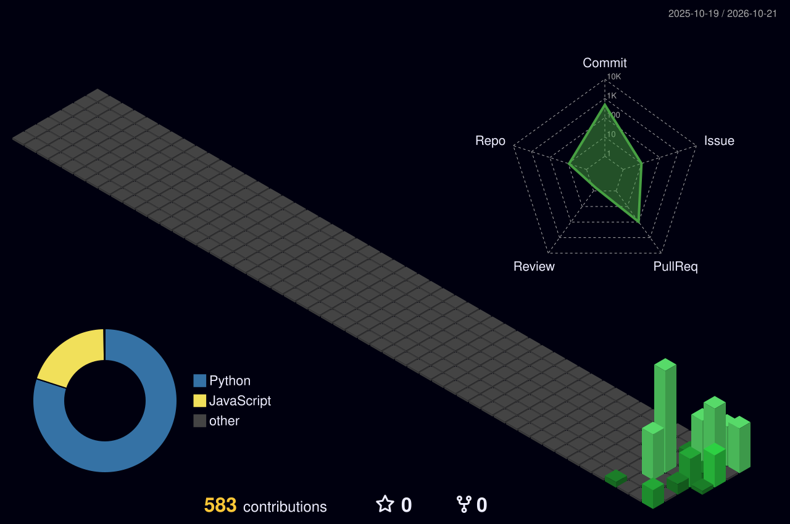

# Mario Martínez Horta

**Klymapo** en código · **Atátoriz** en historias

Datos de día. Historias de noche.

### [▶ Press Start · klymapo.github.io](https://klymapo.github.io/)

---

Analista de datos (Data Analyst Intern en Honeywell) y estudiante de Ingeniería Industrial y Administración. Construyo apps, herramientas de datos y videojuegos con presupuesto cero; como Atátoriz escribo novela negra y ciencia ficción juvenil.

**Herramientas:** Python · SQL · Power BI · JavaScript · Godot · Blender · GitHub Actions

## La ciudad que construí este año

## Partidas guardadas (públicas)

| Proyecto | Qué es |
|---|---|
| [RACOON](https://github.com/Klymapo/RACOON) | PWA local-first para seguir series de anime |
| [ATLAS](https://github.com/Klymapo/ATLAS) | Aventura detectivesca para aprender cinco idiomas |
| [Rupert](https://github.com/Klymapo/RUPERT) | Asistente personal por voz, pensado para el celular |
| [NAOFUMI](https://github.com/Klymapo/NAOFUMI) | Radar freelance local para encargos y cobros |
| [MORIARTY](https://github.com/Klymapo/MORIARTY-) | Estudio de escritura offline |
| [COPOX](https://github.com/Klymapo/COPOX) | Personajes 3D low-poly generados con scripts de Blender |
| [SUNRAKU](https://github.com/Klymapo/SUNRAKU-) | Estudio de voz IA (en diseño) |

Los proyectos privados (videojuego, análisis de datos y escritura) tienen su ficha en el [portafolio](https://klymapo.github.io/).

## Contacto

[Correo](mailto:mariomtzhrt@gmail.com) · [LinkedIn](https://www.linkedin.com/in/mariomh7602)

El Centro de Control anterior quedó archivado en <code>archive/centro-de-control/</code>.
